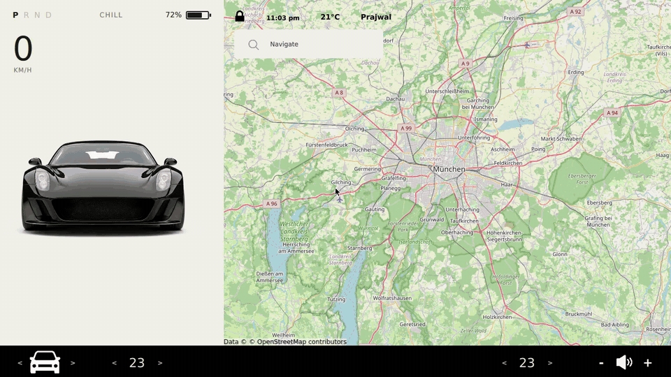

# UI demo (generated)

Recorded automatically by [scripts/record-ui-demo.sh](../master/scripts/record-ui-demo.sh)
from commit 910e22d3d656d040c12277b3b2ecf25ac612361a on master. This branch is replaced
on every push, so do not edit it.

| Step | Result |
|---|---|
| Unlock the car | ✅ passed |
| Lock the car | ✅ passed |
| Car view: left side | ✅ passed |
| Car view: right side | ✅ passed |
| Open the frunk | ✅ passed |
| Open the trunk | ✅ passed |
| Close the frunk | ✅ passed |
| Close the trunk | ✅ passed |
| Start charging | ✅ passed |
| Stop charging | ✅ passed |
| Unlock from the car view | ✅ passed |
| Lock from the car view | ✅ passed |
| Car view: front | ✅ passed |
| Driver temperature up | ✅ passed |
| Driver temperature down | ✅ passed |
| Passenger temperature up | ✅ passed |
| Passenger temperature down | ✅ passed |
| Volume up | ✅ passed |
| Volume down | ✅ passed |
| Find Marienplatz | ✅ passed |
| Zoom in | ✅ passed |
| Zoom out to the city | ✅ passed |
| Find Olympiapark | ✅ passed |
| Zoom in | ✅ passed |
| Find Allianz Arena | ✅ passed |
| Pan the map | ✅ passed |
| Zoom out | ✅ passed |

**Coverage:** all 12 interactive elements are used by the demo ✅
