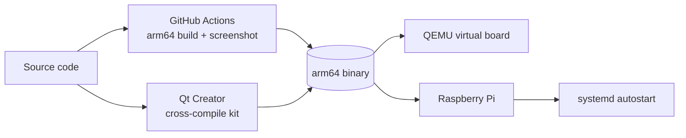

# Target build: Raspberry Pi (arm64)

The desktop build runs on your PC. The **target build** is the same app compiled
for the 64-bit ARM CPU of a Raspberry Pi 4/5 and linked against the Qt that ships
with the board's operating system.



## Which OS the target build is for

**Raspberry Pi OS Trixie, 64-bit** (Debian 13, Qt 6.8).

The app uses `QtLocation` for the map. QtLocation only exists from Qt 6.5, so the
older Raspberry Pi OS Bookworm (Qt 6.4) cannot run it.

| File | Purpose |
|---|---|
| `.github/workflows/target-build.yml` | Builds for arm64 on GitHub, starts the app, saves a screenshot |
| `CMakeLists.txt` | CMake build (Qt 6's recommended build system; `TestPrototype.pro` still works) |
| `cross/toolchain-rpi-aarch64.cmake` | Toolchain file for cross-compiling on an x86 PC |
| `cross/make-sysroot.sh` | Creates the sysroot from a board or from an OS image file |
| `scripts/deploy-to-target.sh` | Copies the binary to a board and runs it, or installs it as a service |
| `scripts/target-runtime-packages.txt` | Qt runtime packages the board needs |
| `deploy/infotainment.service` | systemd unit to start the UI at boot (kiosk) |

---

## 1. Automatic build on GitHub (no setup)

Every push runs **Target build** on a free ARM64 GitHub runner inside a Debian 13
container. It:

1. installs the same Qt 6.8 packages Raspberry Pi OS Trixie uses,
2. builds `TestPrototype` with CMake and checks it is an `ARM aarch64` binary,
3. starts the app on a virtual 1280x720 display, fails if it crashes or a QML
   module/plugin is missing, and takes a screenshot after 15 s,
4. uploads `TestPrototype-arm64-trixie.tar.gz`, `screenshot.png` and
   `startup.log` (Actions tab → the run → **Artifacts**).

Pushing a tag such as `v0.2` also attaches the tarball and screenshot to a GitHub
Release.

If you use a Thunderforest key, add it as a repository secret named
`THUNDERFOREST_KEY` (Settings → Secrets and variables → Actions).

## 2. Cross-compile in Qt Creator

This is the day-to-day development loop: build on the PC, deploy and debug on the
board from Qt Creator.

### One-time setup

1. **Host tools**
   ```bash
   sudo apt install g++-aarch64-linux-gnu gdb-multiarch cmake ninja-build rsync symlinks
   ```
2. **Host Qt of the same version as the board.** Check the board's version
   (`apt-cache policy qt6-base-dev`, 6.8.x on Trixie) and install the matching
   *Qt 6.8.x → Desktop gcc 64-bit* with the Qt Online Installer. The host Qt
   provides `moc`/`rcc`; the board's Qt provides the libraries.
3. **Sysroot** (the board's headers and libraries), from either source:
   ```bash
   cross/make-sysroot.sh ssh pi@raspberrypi.local       # a board or the QEMU VM
   cross/make-sysroot.sh image <raspios-trixie-arm64>.img   # no hardware needed
   ```
   Re-run it whenever you install new `-dev` packages on the board.

### Kit in Qt Creator (Edit → Preferences)

| Section | Setting |
|---|---|
| Devices | Add → **Remote Linux Device**: host `raspberrypi.local` (or `localhost`, port `2222` for the QEMU VM), user `pi`, deploy your SSH key, **Test** |
| Kits → Compilers | Add GCC C `/usr/bin/aarch64-linux-gnu-gcc` and C++ `/usr/bin/aarch64-linux-gnu-g++` |
| Kits → Debuggers | Add `/usr/bin/gdb-multiarch` |
| Kits → Kits | Add **RPi Trixie arm64**: device type *Remote Linux Device*, device as above, sysroot `~/rpi-sysroot`, the compilers and debugger above, Qt version *None* |
| Same kit → CMake Configuration | Add `CMAKE_TOOLCHAIN_FILE:FILEPATH=%{ActiveProject:Path}/cross/toolchain-rpi-aarch64.cmake` and `QT_HOST_PATH:PATH=/home/<you>/Qt/6.8.x/gcc_64` |

The Qt version is left as *None* because the qmake-based Qt version registry
cannot describe "host tools + board libraries"; CMake finds Qt through the
toolchain file and `QT_HOST_PATH` instead.

### Build, deploy, run

1. Open `CMakeLists.txt` (not the `.pro`) and enable the **RPi Trixie arm64** kit.
2. **Ctrl+B** builds. `file build/.../TestPrototype` should say `ARM aarch64`.
3. **Run** deploys the files from the `install()` rule (default
   `/opt/TestPrototype/bin`) and starts the app over SSH. Make the folder writable
   once on the board:
   `sudo mkdir -p /opt/TestPrototype/bin && sudo chown pi: /opt/TestPrototype/bin`
4. Projects → Run → Environment: `QT_QPA_PLATFORM=eglfs` for fullscreen on Pi OS
   Lite, or `QT_QPA_PLATFORM=wayland` + `WAYLAND_DISPLAY=wayland-0` +
   `XDG_RUNTIME_DIR=/run/user/1000` to show it on the Pi's desktop.
5. **Debug** (F5) works the same way through `gdbserver` on the board
   (`sudo apt install gdbserver`).

Command-line equivalent:
```bash
cmake -S . -B build-rpi -G Ninja \
  -DCMAKE_TOOLCHAIN_FILE=cross/toolchain-rpi-aarch64.cmake \
  -DQT_HOST_PATH=$HOME/Qt/6.8.3/gcc_64
cmake --build build-rpi
```

## 3. Test without hardware: QEMU virtual board

Debian 13 arm64 has the same userspace and Qt version as Raspberry Pi OS Trixie,
so the target binary runs on it unchanged.

```bash
sudo apt install qemu-system-arm qemu-efi-aarch64 qemu-utils
mkdir -p ~/vpi && cd ~/vpi
wget https://cloud.debian.org/images/cloud/trixie/latest/debian-13-nocloud-arm64.qcow2
qemu-img resize debian-13-nocloud-arm64.qcow2 +10G
cp /usr/share/qemu-efi-aarch64/QEMU_EFI.fd .

qemu-system-aarch64 -M virt -cpu cortex-a72 -smp 4 -m 4G -bios QEMU_EFI.fd \
  -drive if=virtio,file=debian-13-nocloud-arm64.qcow2,format=qcow2 \
  -device virtio-gpu-pci -display gtk \
  -device qemu-xhci -device usb-kbd -device usb-tablet \
  -netdev user,id=net0,hostfwd=tcp::2222-:22 -device virtio-net-pci,netdev=net0
```

Inside the VM (log in as `root`, no password):
```bash
apt update && apt install -y openssh-server sudo rsync gdbserver weston cloud-guest-utils
adduser pi && usermod -aG sudo,video,render,input pi
growpart /dev/vda 1 && resize2fs /dev/vda1
```

From the PC, deploy the CI artifact or your Qt Creator build:
```bash
scripts/deploy-to-target.sh build-rpi/TestPrototype pi@localhost 2222
```
To see the UI, start `weston` in the VM window first; the script then runs the
app on Wayland. Without a compositor it falls back to `eglfs`, which needs a real
GPU, so use `QT_QPA_PLATFORM=linuxfb QT_QUICK_BACKEND=software` there instead.

What the VM proves: the binary, its Qt dependencies, the QML modules, map
plugin, deployment and startup. What it does not: Pi GPU performance, `eglfs`
on the VideoCore GPU, touch, GPIO, boot configuration.

## 4. Real Raspberry Pi

1. Flash **Raspberry Pi OS (64-bit), Trixie** with Raspberry Pi Imager and enable
   SSH in its settings.
2. Deploy and run (installs the Qt runtime packages first):
   ```bash
   scripts/deploy-to-target.sh TestPrototype pi@raspberrypi.local
   ```
3. Start at boot in kiosk mode:
   ```bash
   scripts/deploy-to-target.sh TestPrototype pi@raspberrypi.local 22 --service
   ```
   The service uses `eglfs` (fullscreen, no desktop). On Pi OS with desktop,
   either boot to console (`sudo raspi-config` → System → Boot → Console) or change
   `QT_QPA_PLATFORM` in `/etc/systemd/system/infotainment.service`.
