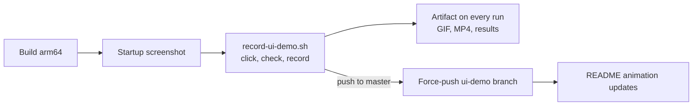

# Automated UI demo and feature checks

The pipeline (`.github/workflows/target-build.yml`) doesn't stop at "the app starts".
After the build, `scripts/record-ui-demo.sh`:

1. starts the app on a virtual 1280x720 display (Xvfb),
2. records the screen with ffmpeg,
3. clicks through every feature with xdotool, like a user would, including a map
   tour: it searches Marienplatz, Olympiapark and Allianz Arena and zooms in and
   out between them,
4. checks after each step that the part of the screen it expects really changed,
5. lists any clickable element of the app that no step tested (coverage),
6. renders `ui-demo.mp4` (captions and red tap markers) and `ui-demo.gif`.



## Where to see the results

| What | Where |
|---|---|
| Pass/fail per feature, coverage | The run's **Summary** page → "UI feature checks" |
| Untested new elements | A yellow warning annotation on the run / pull request |
| GIF, MP4, app log | The run's **Artifacts** → `TestPrototype-arm64-trixie` → `ui-demo/` |
| Latest `master` demo | The README, and the [`ui-demo` branch](https://github.com/RameshPrajwal/Infotainment-Prototype/tree/ui-demo) |

A required step that doesn't change the screen fails the pipeline, so a broken
button shows up as a red pull request, not just a wrong-looking GIF. Map steps
(search, pan, zoom) need the internet for tiles and geocoding, so they are
*optional*: they only warn.

## How the README updates without a commit on master

Updating a file in git always needs a commit, so the GIF does not live on `master`.
On every push to `master` the workflow builds a fresh one-commit branch called
`ui-demo` containing only the GIF, the MP4 and the results, and force-pushes it over
the previous one. The README embeds:

```
https://raw.githubusercontent.com/RameshPrajwal/Infotainment-Prototype/ui-demo/ui-demo.gif
```

So:
- `master` history stays clean: only your feature commits.
- The repository doesn't grow with every new GIF, because the old branch commit is
  replaced, not kept.
- GitHub caches README images for a few minutes, so the new animation can take
  ~5 minutes to appear after the pipeline finishes.

The publish step only runs when every required check passed. If you protect "all
branches" against force pushes in a ruleset later, exclude `ui-demo`.

## Are new features tested automatically?

Partly. The *steps* are written by hand: the script can't know what a new button
is supposed to do, so it can't check it on its own. But the pipeline *notices* new
features you haven't added a step for:

- The app reports every element that reacts to clicks, typing or dragging
  (MouseArea, TextInput, buttons, Tap/Drag handlers).
- After the demo, every such element that no step used is listed under
  **Coverage** in the results, and as a warning on the pull request:
  "Not tested by the demo yet: seatHeater".
- A clickable element without an `objectName` is listed as e.g.
  `(unnamed MouseArea in leftScreen)`, because the demo can't reach it until it
  has a name.

These are warnings, so a feature can be merged before its demo step exists. To
make the pipeline fail instead, set `DEMO_REQUIRE_COVERAGE: "1"` as an `env:` on
the "Record UI demo" step in the workflow.

## Adding a new feature to the demo

1. Give the new element an `objectName` in QML, e.g.

   ```qml
   Rectangle {
       id: seatHeaterButton
       objectName: "seatHeater"
       ...
   }
   ```
   Names are joined with their named parents, so an `up` button inside an item
   named `driverHVAC` is found as `driverHVAC.up`.

2. Add a line to `scenario()` at the top of `scripts/record-ui-demo.sh`:

   ```bash
   step "Seat heater on"   required seatHeater   click seatHeater
   ```
   Format: `step "<caption>" required|optional <region that must change> <action>`.
   Actions: `click <name> [times]`, `search "<text>"`, `type "<text>"`,
   `key <key>`, `drag <name> <dx> <dy>`, `scroll <name> up|down <n>`.
   Add `@top,right,bottom,left` to a region to ignore its borders, e.g.
   `map@130,0,30,0` skips the clock and search box drawn over the map.

3. Push. The pull request's artifact shows the new step, and the merge updates the
   README.

To list every name the app exposes:

```bash
UI_LOCATOR_FILE=/tmp/ui.json ./build/TestPrototype &
sleep 3; cat /tmp/ui.json
```

`UI_LOCATOR_FILE` is read by `Testing/uilocator.cpp`; without it the app behaves
exactly as before.

## Running it on your own Linux machine

```bash
sudo apt install xvfb xdotool ffmpeg jq libxcb-cursor0 fonts-dejavu-core
scripts/record-ui-demo.sh build/TestPrototype ui-demo
```

It runs on a hidden virtual display, so it doesn't take over your screen. Results end
up in `ui-demo/` (`results.md`, `ui-demo.gif`, `ui-demo.mp4`, `app.log`). Optional
settings: `DEMO_GIF_WIDTH` (default 960), `DEMO_GIF_FPS` (10), `DEMO_FPS` (15).
On Windows, run it in WSL2 or let the pipeline do it.
